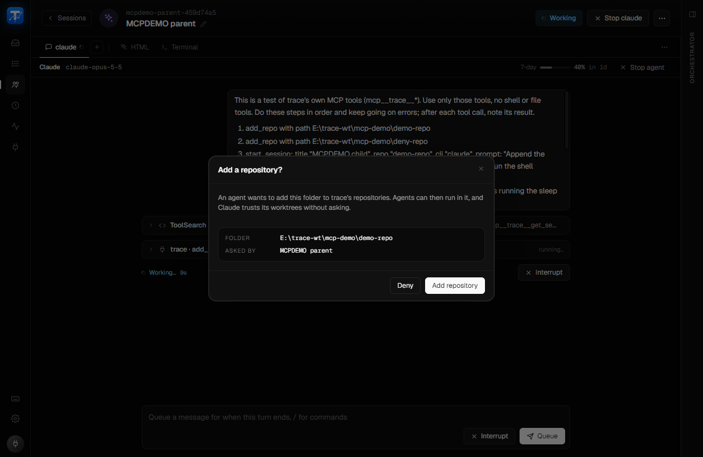
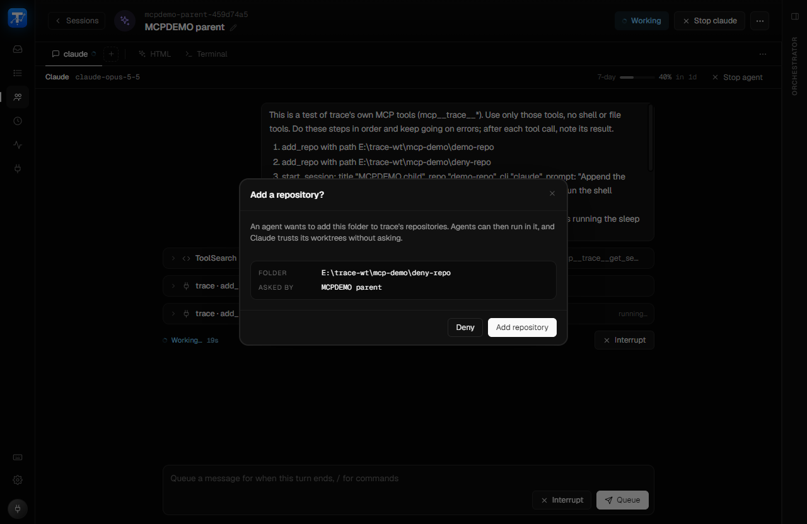
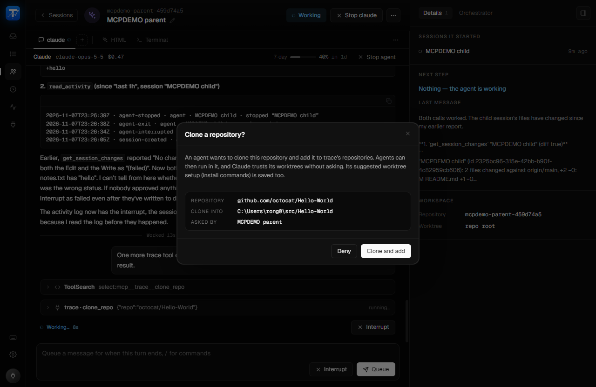
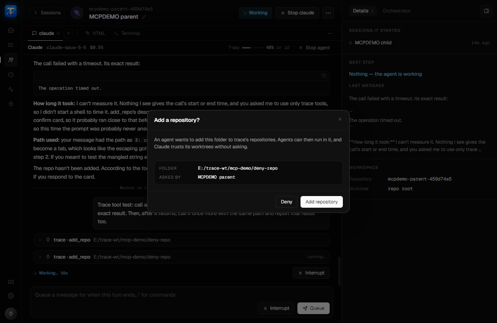

# feat/mcp-tools: live verification

Dev build of `feat/mcp-tools` on Windows 11 (vite 1483, separate WebView2 profile), driven
through the real UI. Every session here was a throwaway (`MCPDEMO …`), deleted afterwards; the
demo repos were registered only through `add_repo` and removed afterwards.

## Confirm card

| | |
|---|---|
| `add_repo`, approved |  |
| `add_repo`, denied |  |
| `clone_repo` (octocat/Hello-World, trace's GitHub sign-in), approved |  |
| `add_repo` left unanswered: the call returned "Not done yet", the card stayed up, a second call picked up the denial |  |

## A Claude chat agent ("MCPDEMO parent") calling the tools

[parent-transcript.txt](parent-transcript.txt): every trace tool call it made and what came
back. The parent started "MCPDEMO child" with `start_session`, then read its changes, PR and
activity, interrupted and stopped it, and was refused on "MCPDEMO bystander" (a session the
user created). The child's own edits were blocked on its permission prompt, so the second
`get_session_changes` ran after the same two edits were made in its worktree by hand.

The first unanswered `add_repo` ("The operation timed out") is Claude Code's 60 s MCP timeout
beating the 150 s wait the first cut used; the wait is now 45 s, and the retry shows the result.

## Codex

- Chat (`codex app-server`): `mcp__trace__list_sessions` and `mcp__trace__update_user` both
  completed ("Shown on the Fleet page.").
- Terminal (the TUI in a PTY): [codex-term-4.png](codex-term-4.png).

Both with `-m gpt-5.6-luna` set in the dev profile's Settings (the user's config default needs a
newer Codex than the installed 0.147.0).
